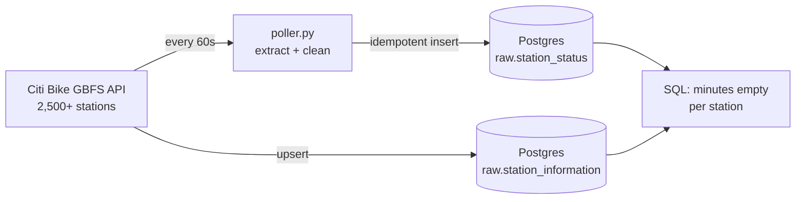

# dockwatch 🚲

**Which Citi Bike stations run empty or full, and when?**

An end to end data pipeline on live NYC + Jersey City bike share data, built in public, step by step.
Every station in the system is polled every minute, cleaned, stored, and turned into answers about the rebalancing problem.

> 🚧 **Work in progress.** I'm building this one concept at a time to learn modern data engineering properly. Follow along in the [build log](#build-log).

## What it does today



## First finding

At noon on a Wednesday, **171 stations were empty**, up from 151 forty minutes earlier.
The stations empty the longest were all in residential neighborhoods far from Midtown:
Jackson Heights, the Bronx, Washington Heights, Bushwick.

Morning commuters ride into Manhattan and dock there, so bikes drain out of the outer boroughs and don't come back until evening. That's the rebalancing problem Citi Bike solves with vans and crews.

## Design decisions

| Decision | Why |
|---|---|
| **Grain:** one row per station per report | Lets us rebuild any station's full timeline |
| **Composite key** `(station_id, last_reported)` | Makes every load **idempotent**: rerunning never creates duplicates |
| `station_id` stored as `text` | The same feed sends both UUIDs and long numeric IDs |
| Filter on `is_installed`, not on dates | 54 uninstalled stations report a fake 1970 timestamp. Fix the cause, not the symptom |
| **Facts vs dimensions** | Status changes every minute (append), names and capacity rarely change (upsert) |
| `timestamptz`, stored in UTC | Servers run on UTC, convert to New York time only at display |
| One transaction per poll cycle | A crash saves nothing partial; the next cycle catches up safely |
| `LEAD()` window function | Turns point in time snapshots into **durations** (how long was it empty?) |

## Build log

| Step | What I built | What I learned | Status |
|---|---|---|---|
| 1 | Explore the GBFS feed | Look at the source before designing anything | ✅ |
| 2 | Cleaning functions + table design | Grain, keys, types, dirty data | ✅ |
| 3 | Postgres in Docker + first load | Docker, volumes, ETL, transactions, idempotency | ✅ |
| 4 | Poller that runs every minute | Logging, error handling, drift free scheduling | ✅ |
| 5 | Station names dimension | Upserts, facts vs dimensions, joins | ✅ |
| 6 | Store only real changes | Duplicate vs redundant data | ⏳ next |
| 7 to 8 | Redpanda (Kafka) producer + consumer | Streaming, offsets, delivery guarantees | ⬜ |
| 9 to 10 | Monthly trip history to Parquet | Batch ingestion, backfills | ⬜ |
| 11 | Airflow DAG | Orchestration | ⬜ |
| 12 | dbt models + tests | Transformation, data quality | ⬜ |
| 13 | Streamlit dashboard | Serving | ⬜ |
| 14 | CI with GitHub Actions | Shipping | ⬜ |

## Run it

Works in GitHub Codespaces (nothing to install locally) or anywhere with Python 3 and Docker.

```bash
python -m venv .venv && source .venv/bin/activate
pip install -r requirements.txt

docker compose up -d            # start Postgres, creates the raw tables
python load_stations.py         # load station names
python poller.py                # poll every 60s (Ctrl+C to stop)
```

Then ask a question:

```bash
docker exec -i dockwatch-db psql -U dockwatch -d dockwatch < sql/queries/empty_minutes_named.sql
```

## Repo map

| File | Purpose |
|---|---|
| `gbfs.py` | Pure cleaning functions shared by every script |
| `poller.py` | The continuous pipeline: extract, clean, load every 60s |
| `load_stations.py` | Upserts station names, locations and capacity |
| `sql/00*_raw_*.sql` | Table definitions, applied on first database start |
| `sql/queries/` | Analysis queries |
| `explore.py`, `step2.py`, `load_once.py` | Learning scripts from earlier steps, kept to show the progression |

## Data

Live data from the public [Citi Bike GBFS feed](https://citibikenyc.com/system-data). Not affiliated with Citi Bike or Lyft.

---

Built by [Eesha Pandit](https://www.linkedin.com/in/eesha-pandit-ba61751b9)
