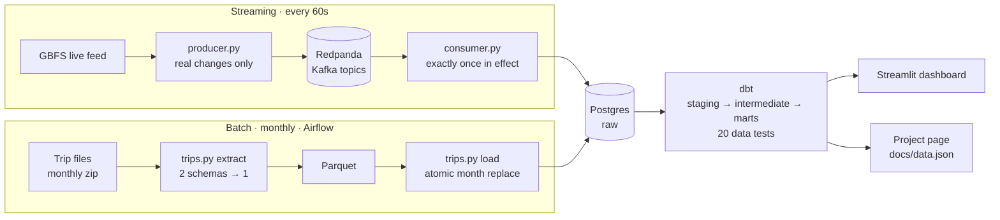

# DOCKWATCH by Eesha Pandit 🚲

**Where did all the bikes go?** An end to end data pipeline on NYC bike share data: a **streaming lane** for live dock status, a **batch lane** for monthly ride history, and **dbt** turning both into tested answers.

🌐 **Project page:** [eeshapandit.github.io/dockwatch](https://eeshapandit.github.io/dockwatch) &nbsp;·&nbsp; ✅ CI on every push

## Architecture



| Layer | Tool | What it does |
|---|---|---|
| Ingest, streaming | Python, confluent-kafka, **Redpanda** | Polls 2,500+ stations every minute, publishes only real state changes |
| Ingest, batch | Python, **Parquet** (pyarrow) | Finds, downloads and normalizes a month of rides (millions of rows) |
| Storage | **PostgreSQL** 16 | Raw landing layer, idempotent writes everywhere |
| Orchestration | **Airflow** 2.10 | Monthly DAG: extract → load → dbt build → export, with retries |
| Transformation | **dbt** 1.12 | 11 models, 20 data tests |
| Serving | **Streamlit** + pydeck, static page | Live empties map, trip flow arcs, per station history |
| Quality | pytest, **GitHub Actions** | Unit tests + full dbt build on a throwaway database, every push |
| Infra | **Docker** Compose | One command runs everything, in Codespaces too |

## Findings

**Live stream, Wednesday Oct 21, noon:** 171 stations had zero bikes, up from 151 forty minutes earlier. The ones empty the longest were all residential: Jackson Heights and Sunnyside in Queens, the Bronx, Washington Heights, East New York. Commuters ride into Manhattan in the morning, dock there, and the bikes don't come back until evening.

**Trip history:** the project page replays an average weekday hour by hour from every ride in the latest month. Red stations lose bikes, green stations gain them, orange lines are the busiest routes.

## Run it

Works in GitHub Codespaces (nothing to install locally) or anywhere with Docker.

```bash
make showcase        # everything: stations, live stream, latest month of rides, dbt, page data
```

Or piece by piece:

```bash
make up              # Postgres
make stations        # station names and locations
make streaming       # Redpanda + producer + consumer   (console: port 8080)
make trips MONTH=202509   # one month of rides            (or MONTH=latest)
make dbt             # build + test every model
make dashboard       # Streamlit                         (port 8501)
make airflow         # Airflow UI, admin / admin         (port 8081)
make export          # refresh docs/data.json for the project page
make test            # unit tests
make down            # stop everything, data is kept
```

## Design decisions

| Problem | Decision |
|---|---|
| Rerunning any load | **Idempotent everywhere**: composite key `(station_id, last_reported)` + `on conflict`, months replaced atomically |
| 54 stations report a 1970 timestamp | Traced to `is_installed = false` and filtered on the **cause**, with a dbt test as a safety net |
| 1,700 rows a minute from heartbeats | **Duplicate ≠ redundant**: compare each station's state, publish only real changes |
| Consumer crashes mid batch | Commit Kafka offsets **after** the DB transaction. At least once + idempotent sink = exactly once in effect |
| Pre 2021 files have other columns and no ride id | Normalize both schemas at the edge; build a stable hash id for old rides |
| Trip files and live feed use different station ids | Trip ids match GBFS `short_name`; trip station locations come from the **median** of ride coordinates |
| Snapshots don't say "how long" | `LEAD()` turns rows into state **spells**, split at hour boundaries for minutes empty per hour |
| Laptop sleeps, pipeline pauses | Open spells end where the data ends and are capped at 12 hours, so outages can't invent empty time |
| Airflow and dbt dependency clashes | dbt runs in its **own virtualenv** inside the Airflow image |

## Repo map

| Path | Purpose |
|---|---|
| `gbfs.py` | Pure cleaning + change detection, shared by every live path |
| `producer.py`, `consumer.py` | Streaming lane (Steps 7, 8) |
| `trips.py` | Batch lane: discover, download, normalize to Parquet, load a month (Steps 9, 10) |
| `airflow/dags/` | Monthly DAG (Step 11) |
| `dbt/` | Models and tests (Step 12) |
| `dashboard/app.py` | Streamlit dashboard (Step 13) |
| `.github/workflows/ci.yml` | CI (Step 14) |
| `export_page_data.py`, `docs/` | Project page and its data |
| `sql/` | Raw table definitions and ad hoc queries |
| `poller.py`, `load_stations.py`, `explore.py`, `step2.py`, `load_once.py` | Earlier steps, kept to show the progression |

## Build log

1. Explore the live feed · 2. Clean rows + table design · 3. Postgres in Docker · 4. Poll every minute · 5. Station names (upserts) · 6. Only real changes · 7. Redpanda producer · 8. Consumer · 9. Trip files to Parquet · 10. Monthly loads · 11. Airflow + dbt · 12. Dashboard + CI

## Data

Live station status from the public GBFS feed. Rides from the public Citi Bike System Data trip files. Map geometry from NYC Open Data borough boundaries and Census ZIP areas for New Jersey. Independent project, not affiliated with Citi Bike or Lyft.

---

Built by [Eesha Pandit](https://eeshapanditt11.netlify.app) · [LinkedIn](https://www.linkedin.com/in/eesha-pandit-ba61751b9)
